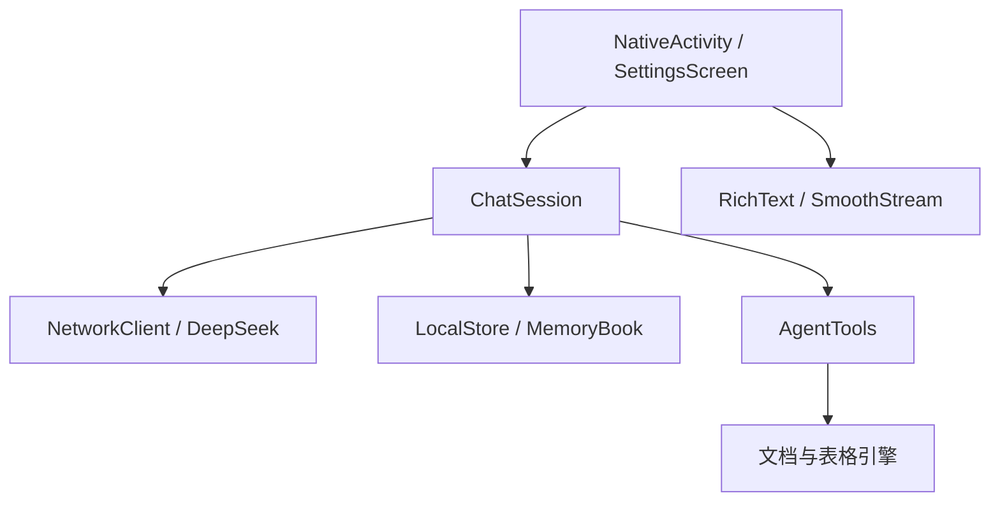

# 架构

`ChatSession` 管理独立于 Activity 的对话数据、请求生命周期、工具往返及持久化检查点。`Conversation` 根据任务组合消息、规则和工具定义；`PromptPolicy` 不伪造模型身份或执行能力。

`SmoothStream` 只处理显示帧合并与一次贴底，`TextReveal` 的游标不修改完整模型输出。`StreamBoundary` 使用原文坐标识别稳定块，`RichText` 将其固定到独立视图，活动尾段按纯文本编辑，完成后应用 Markdown 排版。用户翻阅更早的屏外历史时不更新该回答视图。

文件工具通过 `ArtifactSkills` 校验参数，再交给 Word/PDF/Excel 等本地写入器；文件卡片只在真实文件生成成功后出现。`GeneratedProvider` 向用户选择的目标提供文件访问。

Android Keystore 保护 API Key 的本地加密材料；`MemoryBook` 管理加密记忆。`LocalStore` 的会话 JSON 位于应用私有存储，不能误称端到端加密。

主机测试覆盖请求与产物逻辑，设备测试源码保留在 `test/android`。帧耗时、键盘、字体缩放与屏幕阅读器必须通过设备验收。
